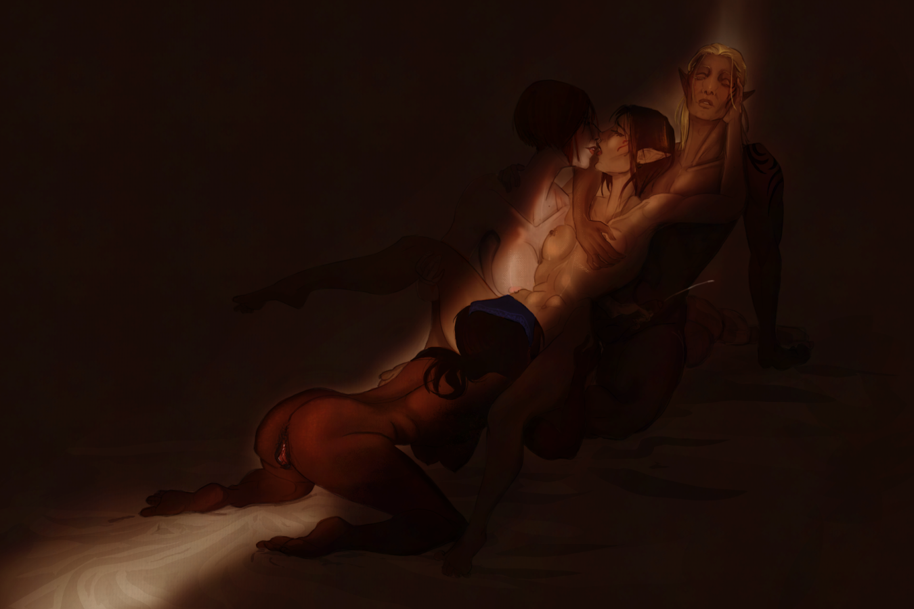
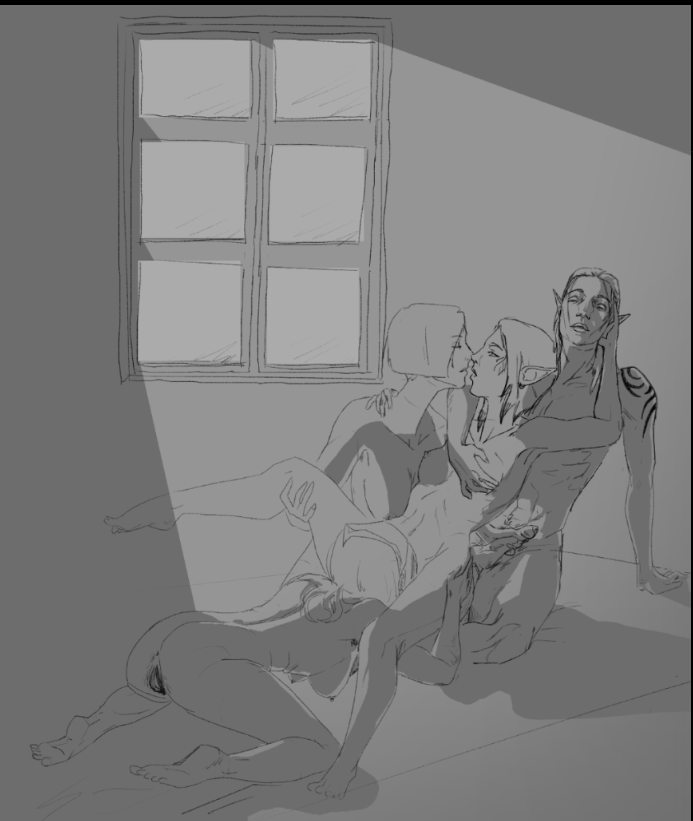
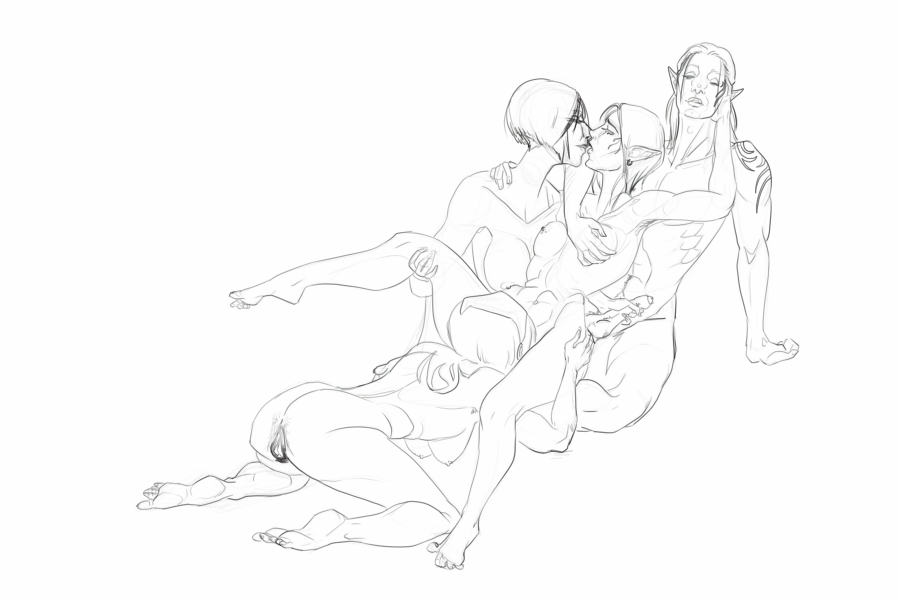

On October 21, 2026, EA closed BioWare, a legendary RPG studio. BioWare published Dragon Age: Origins and Mass Effect, two games extremely formative to who I am as a person. 

These were games pushing boundaries at their time, allowing portrayals of LGBT relationships. It was writing like this that allowed teenage me to safely explore my own identity and sexuality, trying on bisexuality before I was comfortable officially claiming that label. 

It planted the first seeds of polyamory within me. And uh, also promiscuity.  

There's an opportunity for a foursome in Dragon Age: Origins, and that fascinated 16-year-old me. 

Late in the game, if you're romancing both Leliana and Zevran (and uh I was usually romancing everyone......), both will volunteer to join you when you proposition her in The Pearl. Little 16-year-old me was fascinated. I learned that you _can_ have your cake and eat it too. 

So naturally, this is the scene I chose to portray as my homage to BioWare. 

I wanted to lean into composition here: I looked through some explicit references but everything was, of course, super tacky and corny and focused on "hey look at all these genitals clashing". Sex without eroticism is cheap. Sure they're fucking, but who cares? 

I wanted something sensual, something teasing. A peep show, almost. I remembered that if you have Oghren in your party, he can interrupt your little fade-to-black scene, so I wanted to play with the idea of someone cracking the door open to spy on the fabled Gray Warden and their companions. 

The lineart troubled me a little. I was quite unhappy with it at first, but it was ultimately the sort of self-doubt that apparently tends to precede creative breakthroughs.

Here's before and after I redrew everything:

The before is a little bit more fluid, a little bit more "construct figures" rather than "think about what a figure would look like". I've been taking a foundational illustration class too, and I took the opportunity to incorporate what I've learned there so far. 

Lastly, I knew I wanted some kind of high-contrast lighting. A friend pointed me at Caravaggio's [The Calling of St. Matthew](https://en.wikipedia.org/wiki/The_Calling_of_Saint_Matthew) as some inspiration, which pushed me in the right direction. 