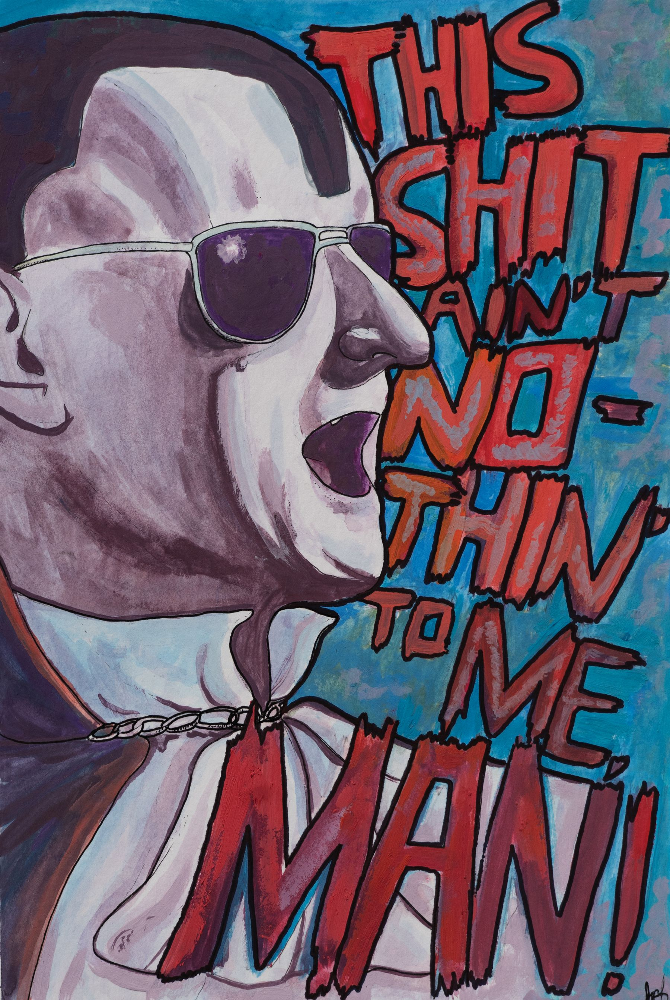
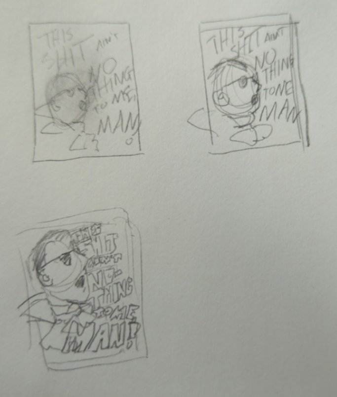

I've got a ~treat~ for you today, blog readers, if there are any of you out there --

A traditional piece! 

I'm sure I don't have to tell you about [Dracula Flow](https://www.youtube.com/watch?v=1Onr4z2fdDM), recovered footage of the vampire count himself spittin' bars. 

Dracula Flow has been a source of joy for my friends and I over the years. "This shit ain't nothin to me, man" has become a sort of mantra. 

So it's what I was drawn towards to make a little catharsis piece for leaving my job. This piece was painted in gouache, which is quickly becoming one of my favorite mediums because it's messy and leads to happy accidents. A few accents with pen and colored pencil to sharpen edges and such. This one's actually available [as a print](https://www.inprnt.com/gallery/weirdoqueen/dracula-flow/) if you're so inclined. 

Here are some thumbnails where I worked out how the head vs text placement should go.

