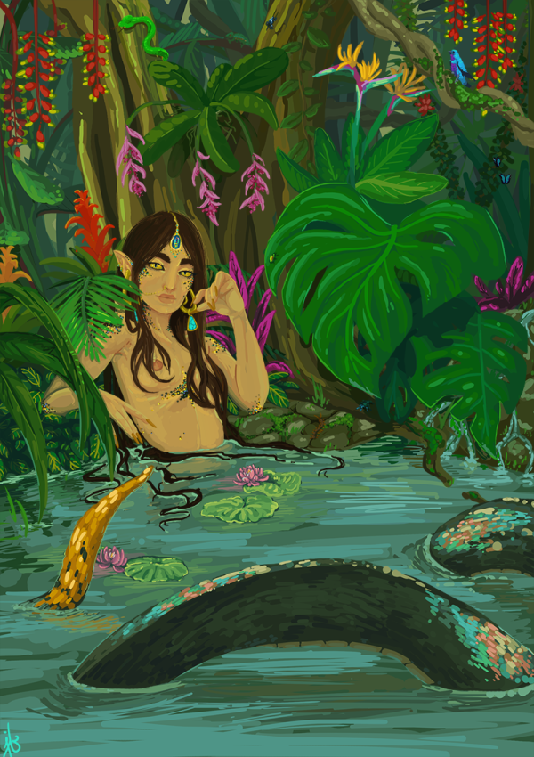
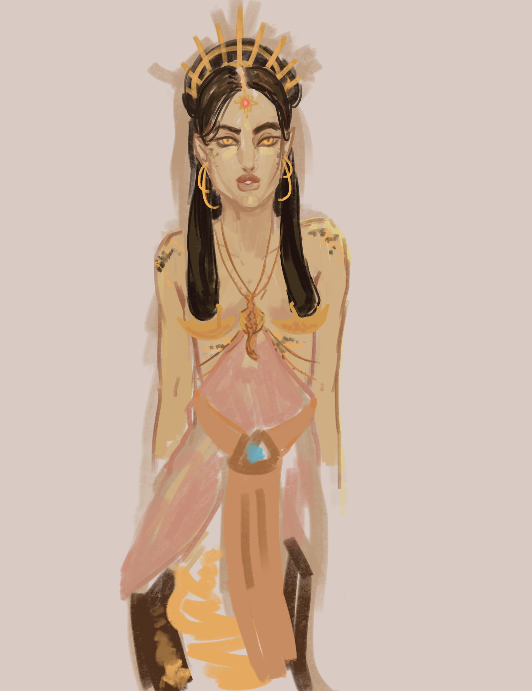
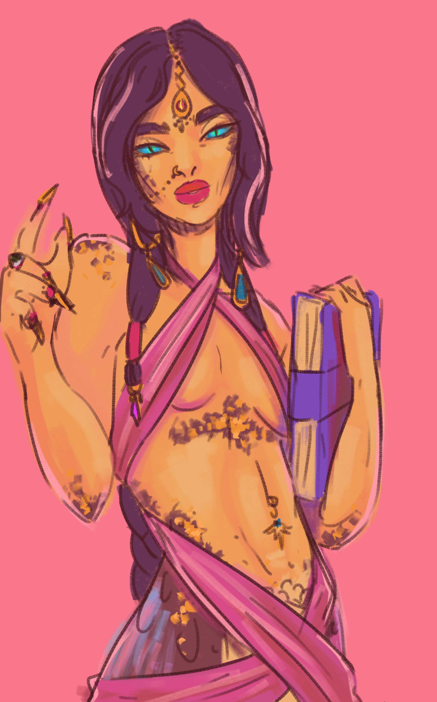
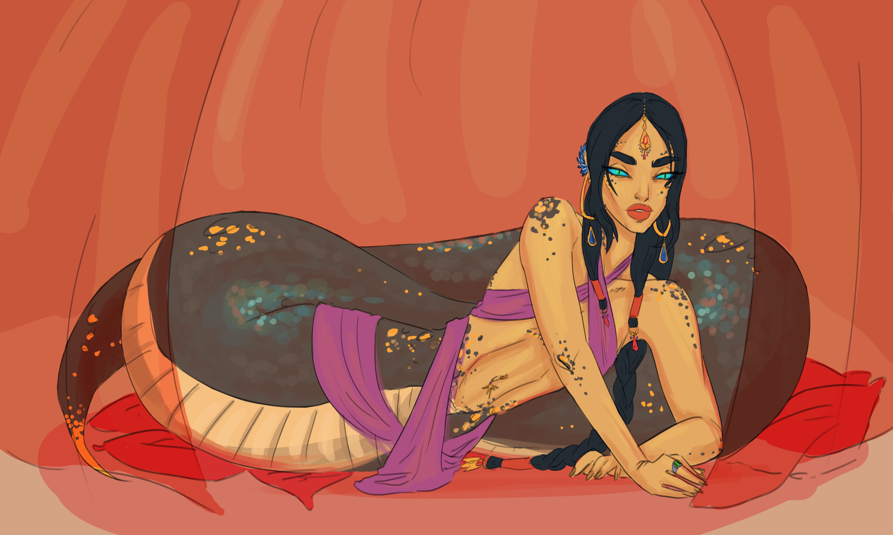

Another throwback today! This is a previous D&D character, a sorcerer/warlock (sorlock, if you will) named Sylvana Swiftscale. I wanted to do a half-snake character. She's some kind of lost princess, I don't remember her backstory much. But she was an excuse for me to learn a Spanish accent.

Here she is lounging in a pond. Gazing luridly. Love a lurid gaze. 

And for bonus points, here are a bunch of other little doodles of her:

