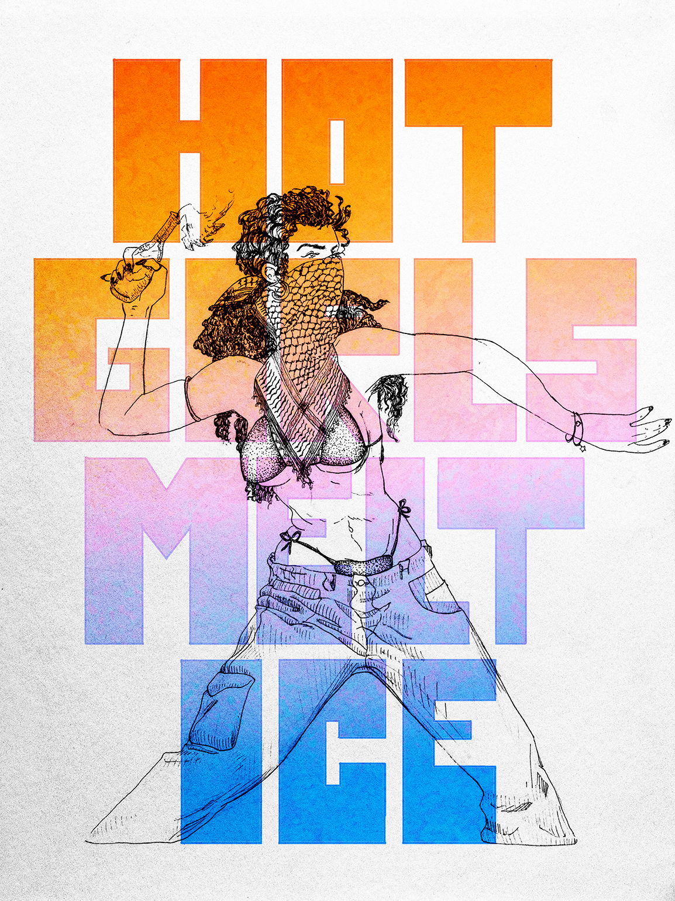

I'm so excited to share today's finished piece!

I started this piece maybe a year ago now, when ICE murdered Alex Pretti and Renne Nicole Goode in separate incidents. For whatever reason, I didn't finish it then. I recently found the pencil drawing I had made, and decided it was worth the attempt to finish it. I have so many unfinished pieces, and I keep starting new ones. At least some of these deserve to see the light of day. 

My intent was to create a visual and slogan to make the idea of ICE abolition palatable to the average person, something fashionable, even. If every teenager girl in the US dreams of a better future, nothing will stop them from achieving it. 

It's only half true for me to describe this as traditionally made - I drew and inked the figure traditionally, then digitally drew the lettering on top of a photo of that in Photoshop, and used masks and overlays and all that to finish off the coloring. 
