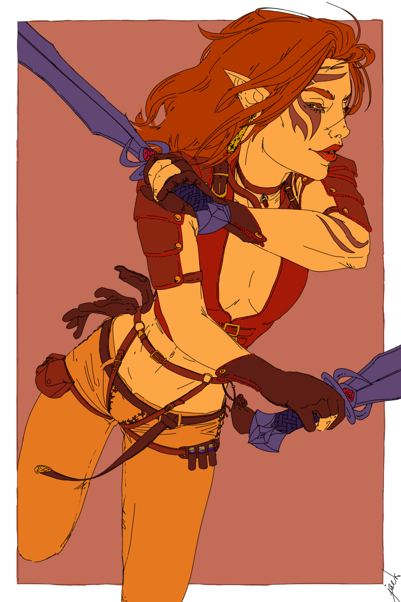
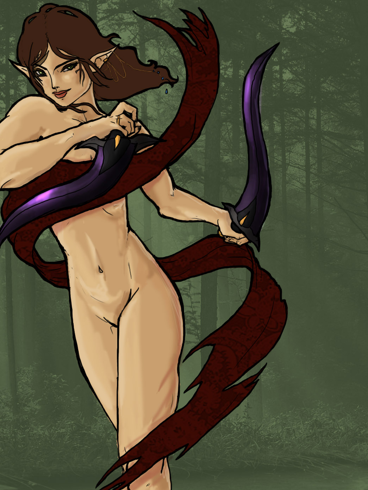
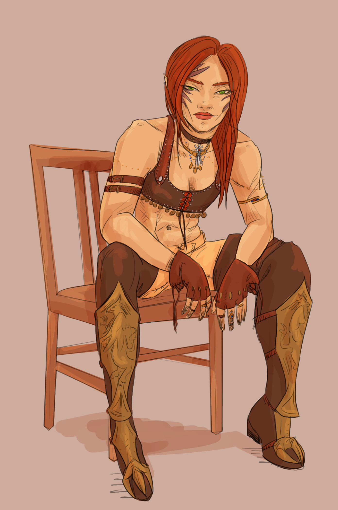
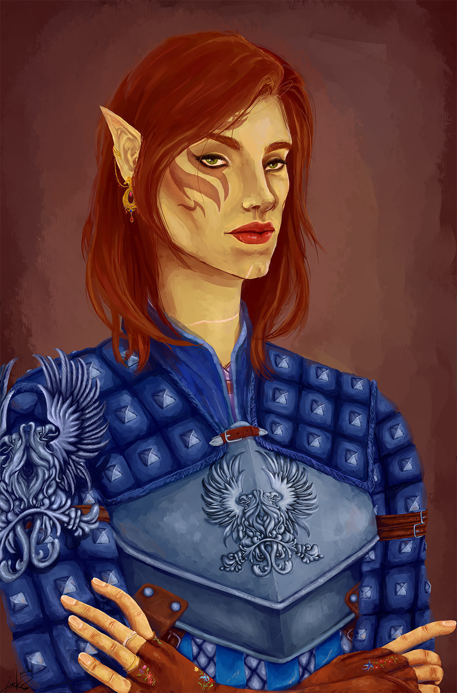
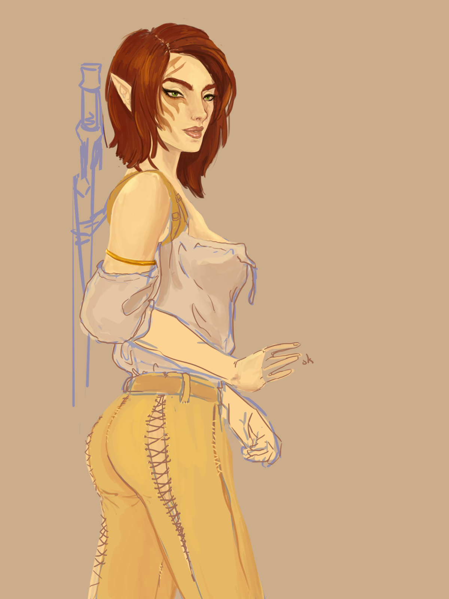

Today's work features probably my oldest original character (well - I guess it's debatable whether a custom player character from a video game is original or not......) - Xan'Thia Tabris, city elf from Dragon Age: Origins.

I've carried this character with me since I was 16 or so, from my second playthrough of the game. I've drawn her a lot over the years, as you can imagine, but today I'll share the highlights. 

This is the most recent finished piece, and one of my favorites I've done - I was experimenting with flat colors, and her dual-wielding allowed for so much movement. I'm not sure when exactly I finished this, perhaps around 2017. 

This piece feels quite similar to another one I did when I was in high school, around 2012. 

It's interesting to observe that I was subconsciously working through the same idea over and over again. It's also interesting to note that I was a fan of bold outlines even back then!

Here's a selection of my favorite works featuring Xan through the years, varying in completion / amounts of effort:

